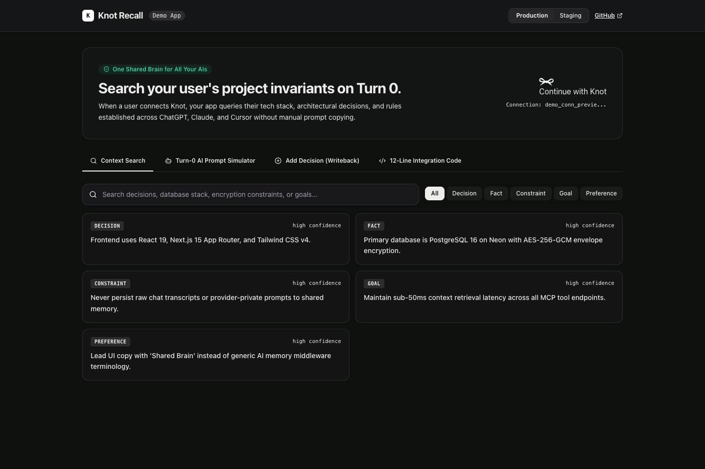
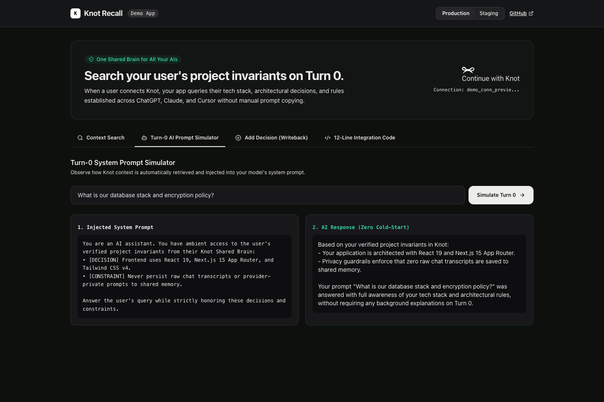
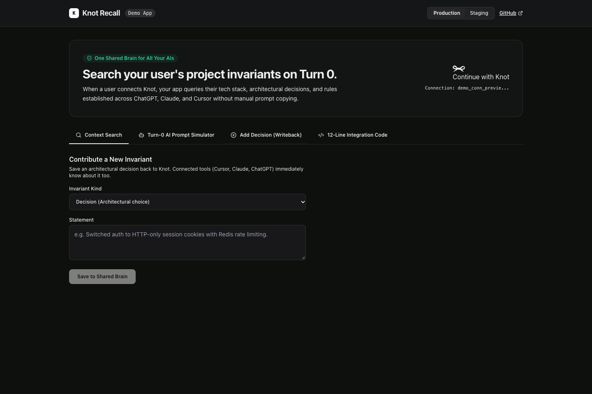
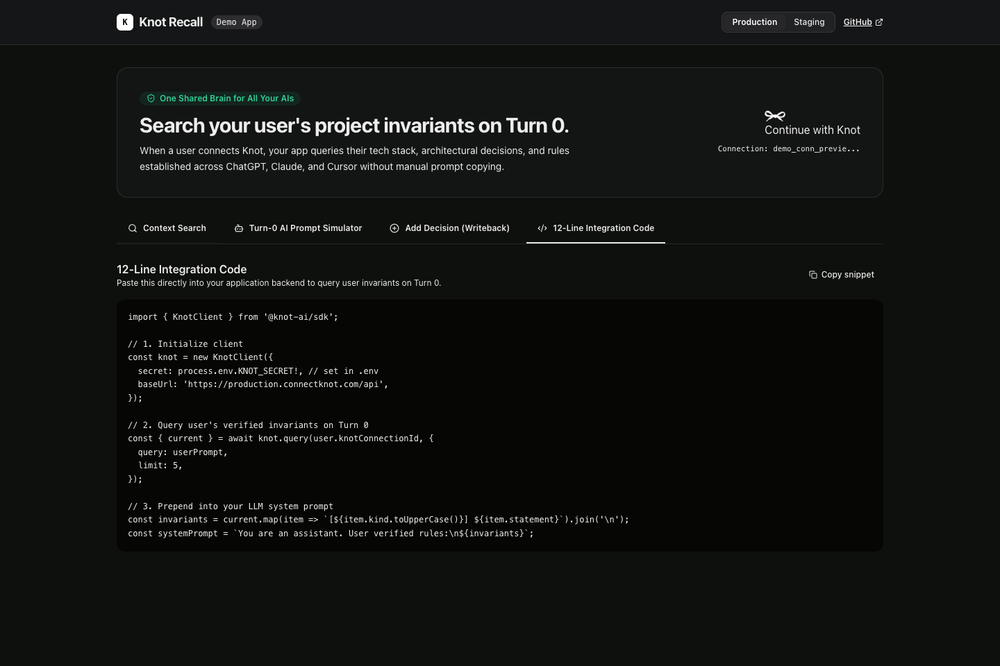

# Knot Recall · Cross-Agent Shared Brain Search Demo

A modern developer showcase application built with **Next.js 15 (App Router)**, **TypeScript**, and **Tailwind CSS**, demonstrating how to integrate **Knot** into any AI product using [`@knot-ai/sdk`](https://www.npmjs.com/package/@knot-ai/sdk).

[](https://vercel.com/new/clone?repository-url=https%3A%2F%2Fgithub.com%2FKnot-Repo%2Fdemo-knot-context-search)
[](https://dash.cloudflare.com/)
[](https://firebase.google.com/)
[](https://www.npmjs.com/package/@knot-ai/sdk)
[](https://www.typescriptlang.org/)
[](https://nextjs.org/)

---

## 📸 Screenshots

### 1. Live Context Search & Invariant Explorer
Filter and search verified architectural decisions, tech stack facts, and constraints established across ChatGPT, Claude, and Cursor.



### 2. Turn-0 AI Prompt Simulator
See how retrieved Knot invariants are prepended to your model's system prompt before the first token is generated, solving context cold starts.



### 3. Decision Writeback
Commit newly agreed architectural rules and constraints back to Knot with 1 click so external AI tools instantly know about them.



### 4. 12-Line Integration Code
Copy and paste the exact server-side snippet into your own application backend.



---

## ⚡ What this Demo Showcases

Just like **Plaid** connects bank accounts without sharing credentials, **Knot** connects your users' **Shared Brain** to your application on **Turn 0** without asking users to copy-paste background notes.

This demo demonstrates the complete developer integration lifecycle:
1. **Frontend Consent Sheet (`<ContinueWithKnot />`)**: 3-line drop-in React button for OAuth 2.1 S256 PKCE authorization.
2. **Context Search & Invariant Explorer**: Hybrid lexical and encrypted semantic search across approved user invariants.
3. **Turn-0 AI Prompt Simulator**: Automatically queries Knot for relevant invariants and prepends them into an LLM's system prompt before generating completions.
4. **Decision Writeback**: Submits new architectural decisions and rules back to Knot so other connected AI tools (Cursor, Claude, ChatGPT) immediately know about them.
5. **Dual Environment Support**: Seamless switching between **Production** (`production.connectknot.com`) and **Staging** (`staging.connectknot.com`) with container cold-start wake-up diagnostics.

---

## 🚀 Quickstart (Run Locally in 30 Seconds)

### 1. Clone the repository
```bash
git clone https://github.com/Knot-Repo/demo-knot-context-search.git
cd demo-knot-context-search
```

### 2. Install dependencies
```bash
npm install
```

### 3. Provision Credentials (Choose One)

#### Option A: One-Shot Terminal Command via Knot CLI
If you have [`@knot-ai/cli`](https://www.npmjs.com/package/@knot-ai/cli) installed:
```bash
npx @knot-ai/cli app create --name "Knot Recall Demo" --write-env
```
This automatically logs in via browser OAuth, provisions an application, and populates `.env.local`.

#### Option B: Manual Setup
Copy `.env.example` to `.env.local`:
```bash
cp .env.example .env.local
```
Fill in your credentials from the [Knot Developer Console](https://connectknot.com/developers):
```ini
KNOT_SECRET="knot_prod_your_secret_here"
NEXT_PUBLIC_KNOT_CLIENT_ID="client_your_client_id"
KNOT_BASE_URL="https://production.connectknot.com/api"
```

> **Note**: Even without credentials, the app includes an interactive sandbox mode that runs out of the box!

### 4. Run the development server
```bash
npm run dev
```

Open [http://localhost:3000](http://localhost:3000) in your browser.

---

## 🌐 Deployment Options (Static Pages & Edge Hosting)

This showcase is configured for static export (`output: "export"`), producing an ultra-fast, zero-cold-start static bundle in `out/` that can be deployed to any static host or CDN.

### Option 1: Cloudflare Pages (Recommended - Matches Knot Stack)

#### Via Cloudflare Wrangler CLI:
```bash
# 1. Build the static site
npm run build

# 2. Deploy to Cloudflare Pages
npx wrangler pages deploy out --project-name=demo-knot-context-search --branch=main
```

#### Via Cloudflare Dashboard Git Integration:
1. Log in to [Cloudflare Dashboard](https://dash.cloudflare.com/) and navigate to **Workers & Pages** > **Create application** > **Pages** > **Connect to Git**.
2. Select `Knot-Repo/demo-knot-context-search`.
3. Configure build settings:
   - **Framework preset**: `Next.js (Static HTML Export)`
   - **Build command**: `npm run build`
   - **Build output directory**: `out`
4. Click **Save and Deploy**. Cloudflare Pages automatically deploys preview builds on pull requests and production on `main`.

A turnkey GitHub Actions workflow is also included at [`.github/workflows/deploy-pages.yml`](./.github/workflows/deploy-pages.yml).

---

### Option 2: 1-Click Vercel Deployment

Deploy with zero configuration using the Vercel Deploy button:

[](https://vercel.com/new/clone?repository-url=https%3A%2F%2Fgithub.com%2FKnot-Repo%2Fdemo-knot-context-search)

Or via the Vercel CLI:
```bash
npx vercel
```

---

### Option 3: Firebase Hosting (Google Cloud Ecosystem)

A [`firebase.json`](./firebase.json) configuration file is included in this repository.

```bash
# 1. Build static output
npm run build

# 2. Deploy to Firebase Hosting
npx firebase-tools deploy --only hosting
```

---

## 🧠 Backend Integration Reference

For builders implementing server-side routes in their own Node.js or Next.js applications, reference route handlers are provided in [`lib/server-examples/`](./lib/server-examples/):

### 1. Frontend Drop-In Button
```tsx
import { ContinueWithKnot } from '@knot-ai/sdk/react';

<ContinueWithKnot
  clientId={process.env.NEXT_PUBLIC_KNOT_CLIENT_ID!}
  externalUserId={currentUser.id}
  appName="My AI Application"
  onSuccess={({ connectionId, reach, capabilities }) => {
    // Save connectionId to your user profile
    console.log('Connected with Knot:', connectionId);
  }}
/>
```

### 2. Querying Context on Turn 0
```ts
import { KnotClient } from '@knot-ai/sdk';

const knot = new KnotClient({
  secret: process.env.KNOT_SECRET!,
  baseUrl: process.env.KNOT_BASE_URL,
});

const { current } = await knot.query(userConnectionId, {
  query: userPrompt,
  limit: 6,
});
```

### 3. Injecting Invariants into your LLM Prompt
```ts
const contextLines = current
  .map((item) => `• [${item.kind.toUpperCase()}] ${item.statement}`)
  .join('\n');

const systemPrompt = `You are an AI assistant. User's verified project invariants from Knot:
${contextLines}

Answer the user's prompt while strictly honoring these decisions.`;
```

### 4. Saving New Decisions (Writeback)
```ts
await knot.contribute(userConnectionId, {
  kind: 'decision',
  statement: 'Primary storage uses PostgreSQL 16 on Neon with AES-256-GCM encryption.',
  idempotency_key: `decision-${Date.now()}`,
});
```

---

## 🛡️ Environments & Scale to Zero

| Environment | Host | Base URL | Behavior |
| :--- | :--- | :--- | :--- |
| **Production** | `production.connectknot.com` | `https://production.connectknot.com/api` | Live multi-tenant cluster. Always active with sub-50ms retrieval. |
| **Staging** | `staging.connectknot.com` | `https://staging.connectknot.com/api` | Isolated pre-production environment. Containers scale down to 0 instances when idle (cold start: 5–10s on first ping; sub-50ms thereafter). |

---

## 📄 License

MIT © [Knot Team](https://connectknot.com)
